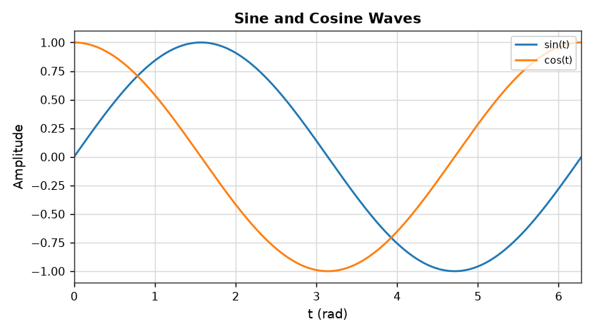

# 01 · Basics and Signal Generation

[← Back to the repository overview](../README.md)

Eleven scripts that build the vocabulary of discrete-time signals: continuous and discrete waveforms, elementary sequences, symmetry, and time transformations. Start here if you are new to DSP.



| # | File | What it does |
|---|---|---|
| 1 | `lab_one_plotting_a_sin_and_cos_wave_as_a_basic.m` | Plots sine and cosine over one period |
| 2 | `lab_two_unit_step.m` | Unit step sequence `u[n]` |
| 3 | `lab_three_unit_sample_sequence.m` | Unit sample (impulse) `δ[n]` |
| 4 | `lab_four_unit_ramp_sequence.m` | Unit ramp `r[n]` |
| 5 | `lab_five_exponential_signal.m` | Exponential signal `a^n` |
| 6 | `lab_six_sampling_of_an_anlog_signal.m` | Samples an analog sinusoid |
| 7 | `lab_seven_converting_an_even_signal.m` | Even part of a signal |
| 8 | `lab_eight_converting_an_odd_signal.m` | Odd part of a signal |
| 9 | `lab_nine_user_input_signal_and_advance_it_by_3_units_of_time.m` | Advances a signal by 3 samples |
| 10 | `lab_ten_user_input_signal_and_dekay_it_by_three_units_of_time.m` | Delays a signal by 3 samples |
| 11 | `lab_eleven_folding_a_discrete_time_signal.m` | Time reversal (folding) |

## Walkthrough

1. **Plotting sine and cosine** — Builds `t = 0:0.01:2*pi` and plots one period of both waves. Look for the 90° phase shift: cosine leads sine by π/2.
2. **Unit step** — `u[n] = 1` for `n ≥ 0`, otherwise 0. A single comparison builds the sequence, and `stem` shows it as discrete samples rather than a continuous line.
3. **Unit sample** — The impulse `δ[n]` is 1 at `n = 0` and 0 elsewhere. It is the building block of convolution and the basis of the DFT.
4. **Unit ramp** — `r[n] = n` for `n ≥ 0`. Note that the ramp is the running sum of the unit step.
5. **Exponential signal** — `a^n` decays when `|a| < 1` and grows when `|a| > 1`. Change the base to see the envelope change.
6. **Sampling an analog signal** — Samples a continuous sinusoid at several rates and overlays the samples on the analog curve. This is the bridge from analog to discrete time.
7. **Even signal** — Even means `x[-n] = x[n]`. The script forms the even part `(x[n] + x[-n])/2`.
8. **Odd signal** — Odd means `x[-n] = -x[n]`. The odd part is `(x[n] - x[-n])/2`.
9. **Advance by 3** — `y[n] = x[n+3]` shifts the signal left. The script prompts for the input sequence.
10. **Delay by 3** — `y[n] = x[n-3]` shifts the signal right. Compare the result with the advance script.
11. **Folding** — Time reversal `y[n] = x[-n]`. Folding plus shifting covers the full set of time transformations.

## Run

```matlab
cd 01_basics
lab_two_unit_step
```
