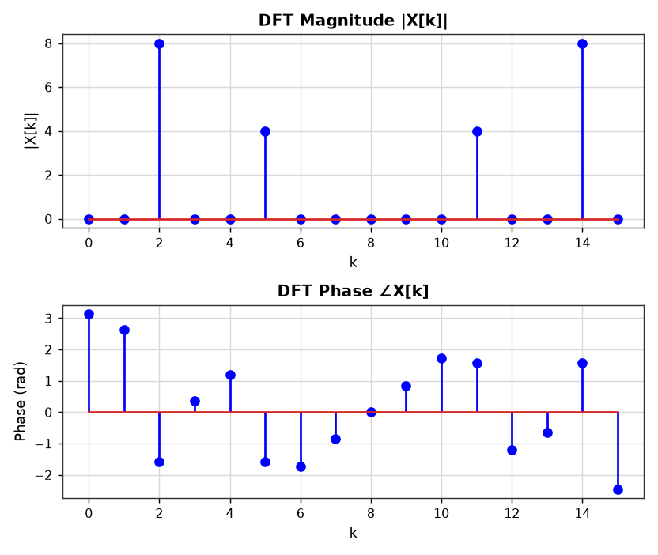

# 02 · Transforms and Convolution

[← Back to the repository overview](../README.md)

Eight scripts on the frequency-domain and algebraic tools that connect a signal to its spectrum: the z-transform, the DFT and its inverse, convolution, and correlation.



| # | File | What it does |
|---|---|---|
| 12 | `lab_twelve_z_transform_of_a_signal.m` | Z-transform of a sequence |
| 13 | `lab_tharteen_crosscorrealtion_of_two_given_signals.m` | Cross-correlation of two signals |
| 14 | `lab_twielve_convolution_of_two_given_signal.m` | Convolution of two signals |
| 15 | `lab_fourteen_discrete_fourier_transform.m` | DFT (manual) vs. FFT |
| 16 | `lab_fifteen_inverse_discrete_fourier_transform.m` | IDFT (manual) vs. IFFT |
| 17 | `lab_sixteen_circular_convolution.m` | Circular convolution |
| 18 | `lab_seventeen_linear_convolution_using_fft.m` | Linear convolution via FFT |
| 19 | `lab_twenty_one_autocorrelation_of_a_signal.m` | Autocorrelation |

## Walkthrough

12. **Z-transform** — Forms the rational z-transform of a sequence and its region of convergence. Poles and zeros come from the numerator and denominator roots.
13. **Cross-correlation** — `xcorr` measures similarity as a function of lag. The peak lag is the delay between the two signals.
14. **Convolution** — Direct sum `y[n] = Σ x[k]h[n-k]`. The output length is `Lx + Lh - 1`.
15. **DFT** — Builds the DFT matrix by hand and compares the result with `fft`. Plots magnitude and phase separately.
16. **IDFT** — The inverse transform reconstructed by hand, then checked against `ifft`. The round trip should return the original sequence.
17. **Circular convolution** — Wraps around modulo `N` instead of sliding linearly. Compare the result with the linear convolution of the same sequences.
18. **Linear convolution via FFT** — Zero-pads both signals to `Lx + Lh - 1`, multiplies the spectra, and inverse-transforms. The result matches direct convolution.
19. **Autocorrelation** — `xcorr(x, x)` peaks at zero lag and is symmetric. It measures how much a signal resembles a shifted copy of itself.

## Run

```matlab
cd 02_transforms
lab_fourteen_discrete_fourier_transform
```
