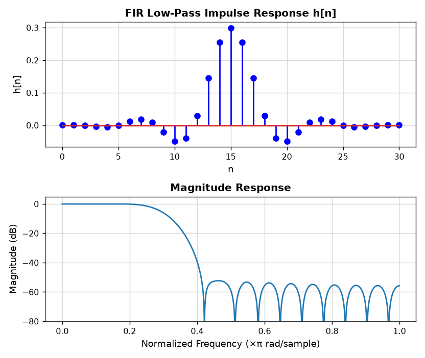

# 03 · Filters and Frequency Response

[← Back to the repository overview](../README.md)

Four scripts on designing and analysing digital filters: FIR window design, IIR Butterworth design, the frequency response of an LSI system, and pole-zero stability.



| # | File | What it does |
|---|---|---|
| 20 | `lab_eighteen_fir_lowpass_filter_design.m` | FIR low-pass filter (window method) |
| 21 | `lab_nineteen_iir_butterworth_filter_design.m` | IIR Butterworth low-pass filter |
| 22 | `lab_twenty_frequency_response_of_an_lsi_system.m` | Frequency response of an LSI system |
| 23 | `lab_twenty_five_pole_zero_plot_and_stability.m` | Pole-zero plot and stability |

## Walkthrough

20. **FIR low-pass** — `fir1` designs a windowed-sinc filter. Increasing the order narrows the transition band but lengthens the impulse response and adds delay.
21. **IIR Butterworth** — `butter` gives a maximally flat passband. Higher orders steepen the roll-off at the cost of a longer transient.
22. **Frequency response of an LSI system** — `freqz` evaluates `H(e^{jω})` from the difference-equation coefficients. The magnitude shows the band shape; the phase shows the delay.
23. **Pole-zero and stability** — `zplane` plots poles and zeros in the complex plane. A causal LSI system is stable when every pole lies strictly inside the unit circle.

## Run

```matlab
cd 03_filters
lab_eighteen_fir_lowpass_filter_design
```
