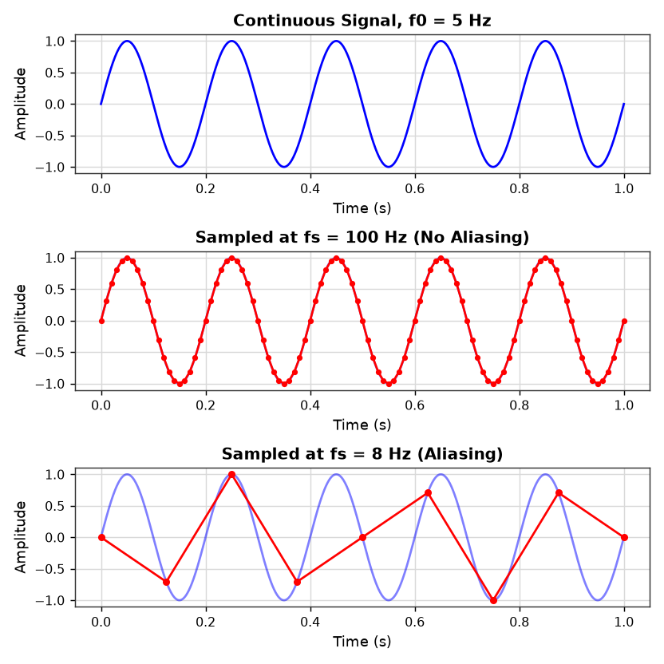

# 04 · Sampling and Spectra

[← Back to the repository overview](../README.md)

Five scripts on moving between the time and frequency domains in practice: aliasing, FFT spectra, multirate operations, quantization, and time-frequency analysis.



| # | File | What it does |
|---|---|---|
| 24 | `lab_twenty_two_sampling_and_aliasing.m` | Sampling above and below Nyquist |
| 25 | `lab_twenty_three_spectral_analysis_using_fft.m` | Single-sided spectrum of summed sinusoids |
| 26 | `lab_twenty_four_downsampling_and_upsampling.m` | Decimation and zero-insertion upsampling |
| 27 | `lab_twenty_six_quantization_and_snr.m` | Uniform quantization and SNR |
| 28 | `lab_twenty_seven_chirp_signal_and_spectrogram.m` | Chirp signal and spectrogram |

## Walkthrough

24. **Sampling and aliasing** — A 5 Hz sinusoid sampled at 100 Hz is faithful; sampled at 8 Hz it folds to a false low frequency. The script plots the analog curve behind both sample sets.
25. **Spectral analysis** — A sum of 50, 120, and 300 Hz sinusoids is transformed with `fft`. The single-sided amplitude spectrum should show one peak per component.
26. **Downsampling and upsampling** — Decimation by 2 keeps every second sample; upsampling inserts zeros. The zero-inserted signal has spectral images that an interpolation filter would remove.
27. **Quantization and SNR** — A uniform quantizer with `b` bits gives roughly `6.02·b + 1.76` dB SNR. The script measures the real value and compares it with the formula.
28. **Chirp and spectrogram** — A linear sweep from 20 to 200 Hz. The spectrogram shows the instantaneous frequency as a diagonal track across time.

## Run

```matlab
cd 04_sampling_and_spectra
lab_twenty_two_sampling_and_aliasing
```
