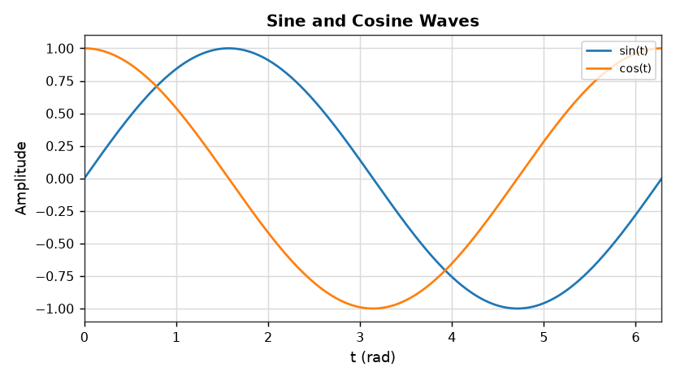
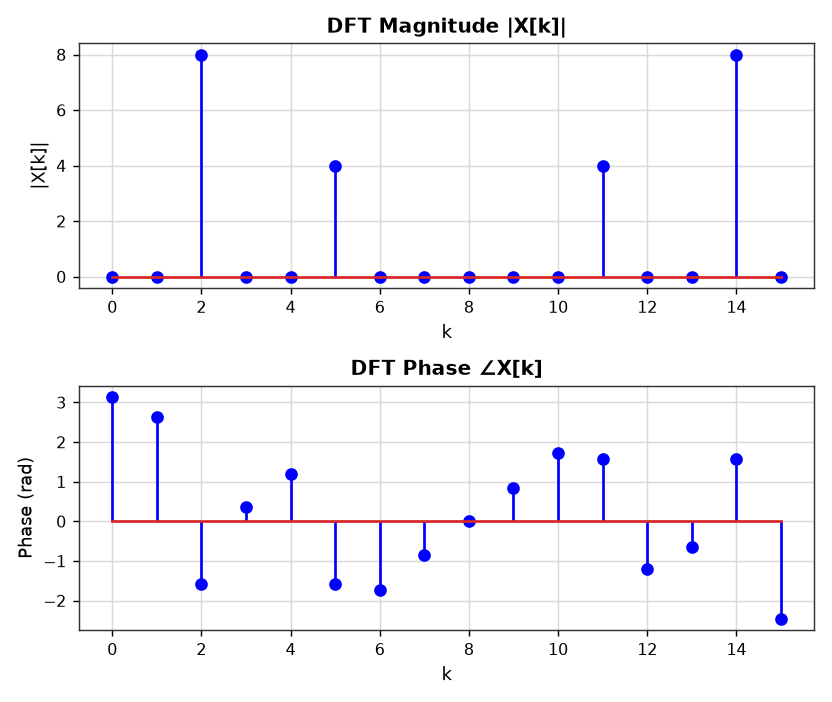
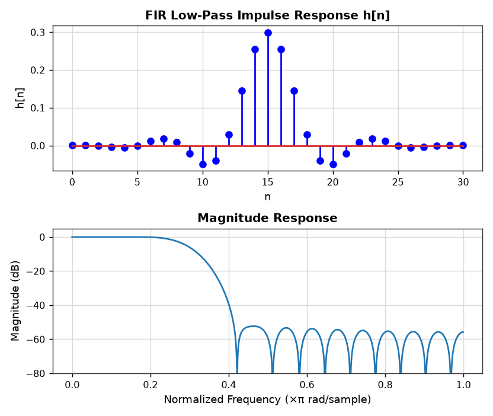
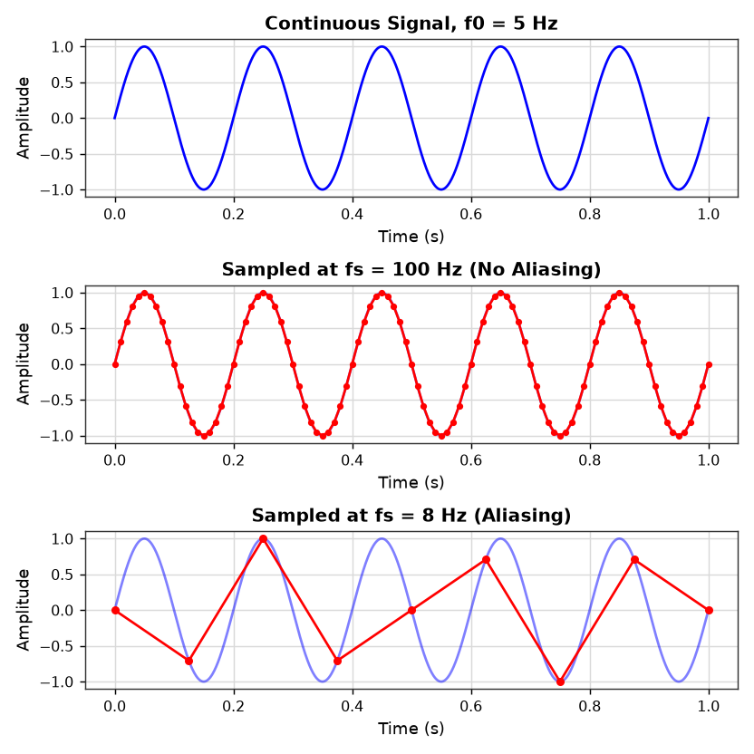

# Digital Signal Processing — MATLAB Labs

28 standalone MATLAB scripts covering DSP from first principles: signal generation, transforms, filtering, and sampling. Every script is self-contained, commented, and produces figures.

| Folder | Labs | Topics |
|---|---|---|
| [`01_basics/`](01_basics/README.md) | 11 | Elementary signals, symmetry, shifting, folding |
| [`02_transforms/`](02_transforms/README.md) | 8 | Z-transform, DFT/IDFT, convolution, correlation |
| [`03_filters/`](03_filters/README.md) | 4 | FIR/IIR design, frequency response, stability |
| [`04_sampling_and_spectra/`](04_sampling_and_spectra/README.md) | 5 | Aliasing, spectra, decimation, quantization, chirp |

Each folder has its own README with a lab-by-lab walkthrough.

## Preview

| | |
|---|---|
|  |  |
|  |  |

## Quick start

```matlab
% Run a script from its folder
cd 01_basics
lab_one_plotting_a_sin_and_cos_wave_as_a_basic

% Or make every lab visible from the repository root
addpath(genpath(pwd));
lab_two_unit_step
```

Scripts that call `input()` prompt for values in the Command Window.

## Requirements

- MATLAB R2016b or newer
- Signal Processing Toolbox for `fir1`, `butter`, `freqz`, `filter`, `xcorr`, `zplane`, `spectrogram`, and `chirp`

## Notes

- Lab numbers follow the order in this repository; file names keep the original course naming.
- The preview images are matplotlib renderings of the same signals, not MATLAB screenshots. Regenerate them with `python docs/previews/generate_previews.py`.
